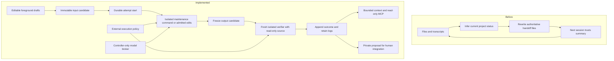

# THE BET

Make it impossible for a session to inherit a “verified” claim detached from the code and execution that earned it. Replace the maintenance daemon’s mutable project memory with durable **change attempts**: immutable input bytes, candidate bytes, declared intent, independently captured check results, and disposition. This destroys the assumption that current project state must be reconstructed by reconciling chat, files, and handoff summaries after each session. Ordinary files remain editable drafts; recorded attempts are authoritative for what was tried and what was checked. `STATE.md` becomes a disposable view, never a fact store.

# RAW BASIS

The supplied blueprint is design evidence, not a deployed measurement. Its external citations and quantitative claims were not independently verified.

- **B1 — INVARIANT, required behavior.** “Coexistence Engineering” explicitly includes manual copy-paste, interactive Claude Code, and Codex changing the same project. The final custodian recommendation requires seeing “edits made outside git.” The machine must admit arbitrary ordinary file edits without requiring a particular authoring tool.
- **B2 — INVARIANT, required behavior.** The final recommendation states: “It never writes to your working tree, merges or pushes,” and places changes on `custodian/*` branches. Background work must not own the foreground index or integration decision. This build leaves integration to the operator.
- **B3 — INHERITED, conflicting authorities.** “Automated Cross-Agent Synchronization” describes transcripts and working-tree reality diverging, followed by artifact checks and rewrites to `PROGRESS.md`. “The Five-File Persistent Memory Architecture” makes `PROGRESS.md` a mutable status record and `DECISIONS.md` an extracted rationale log. The final recommendation substitutes `STATE.md`. These are choices about representing state, not required product behavior.
- **B4 — INHERITED, unvalidated dependencies.** The final recommendation says its code was untested, cost figures came from list prices, and Codex hook payloads containing `cwd` and `transcript_path` were unconfirmed. No working implementation or usage measurements accompany the target.
- **B5 — INVARIANT, evidence requirement.** “Independent Verification and Falsifiable Quality Gates” rejects prose claims of test passage and requires independently executed commands and recorded exit codes before declaring completion.

# THE BREAK

The old design continually repairs “the repository’s current status” when transcripts, manual edits, or checks contradict it. Its mutable status can combine evidence about different bytes.

The new question is “What happened to this attempted change?” A successful check adds a fact about one immutable candidate; it cannot promote a later edit. Failed attempts remain addressable after their code disappears. Imported manual edits have unknown intent until someone supplies it.

The deleted work is authoritative handoff-file synchronization, adjudication between competing prose test claims, and reconstruction of which candidate a recorded outcome describes. Semantic maintenance, test design, and architectural judgment remain real work. This is an authority change, not a promise that content hashing understands code.

# WHAT LOST

The default family—filesystem watcher, stronger model, larger repository map, and synchronized memory files—is an upgrade because it retains retrospective inference and mutable global status. The strongest different reinvention, making a semantic program database authoritative and generating source files from it, loses on B1: unrestricted ordinary text edits would force semantic identity and intent reconstruction back into its admission boundary.

# ARCHITECTURE

**Authority and durable state.** [engine.py](custodian/engine.py) stores bytes in an external Git object archive and events in SQLite. An attempt names its input tree, base commit, output tree, purpose, commands, execution conditions, logs, and disposition. Private refs retain observations, candidate commits, and logs through Git garbage collection, independently of proposal branches. Event-table triggers reject updates/deletes. The owning operator can alter storage; this is not tamperproof evidence against its administrator.

**Capture and admission.** The recorder reads tracked and nonignored untracked files, retaining deletions, executable modes, and symlink contents. A scan constructs a candidate, not an atomic claim about the live directory. Unsupported file types and submodules fail explicitly. Ignored files are absent; tracked secrets remain capture material. [config.py](custodian/config.py) loads policy outside the repository: checks, protected paths, scheduling, runtime, and model disclosure. Neither candidate code nor a model response can replace that policy.

**Execution.** The controller appends `attempt_started(RUNNING)` before materialization. A maintenance command receives a writable private candidate, or [edits.py](custodian/edits.py) admits bounded replacements with exact original-content hashes. The controller freezes the output, rejects protected-path changes, then constructs a fresh verifier workspace. [sandbox.py](custodian/sandbox.py) uses Linux user/mount/process/network namespaces: candidate at `/work`, writable for mutation and read-only for verification; fresh temporary storage; no foreground/state/home mount; no inherited credentials or host network; Git administrative files masked. Timeout, cancellation, and output limits terminate execution. Isolation failure never silently becomes trusted execution.

**Runtime identity.** [runtime.py](custodian/runtime.py) can copy a selected executable/dependency closure into an immutable-to-worker artifact. Each execution verifies its file inventory, hashes, modes, and symlinks before mounting that artifact without host-runtime fallback. Evidence records its content identity. The host kernel and external-service state are not thereby pinned. Without a runtime artifact, the available host userspace is explicitly recorded as unpinned. Additional read-only dependency mounts are operator-selected disclosure boundaries. Explicit `trusted` mode retains compatibility for operator commands and loses isolation guarantees; model-produced changes require isolated mode.

**Outcomes and recovery.** Append `attempt_finished(PASSED|FAILED|REJECTED|UNVERIFIED|CANCELLED|INTERRUPTED)` with retained evidence. Missing checks produce `UNVERIFIED`; a passing check is an observed command result, not a proof of semantic correctness. Intermediate execution evidence is durable. Recovery obtains the exclusive execution lease, marks abandoned attempts interrupted, removes disposable workspaces, and reconciles proposal refs. It never converts a partial run to success. Passing mutations can receive at most three waiting private `custodian/*` branches. Human disposition releases a slot without deleting evidence or performing integration.

**Always-on control.** [daemon.py](custodian/daemon.py) polls cheap metadata while idle, captures after quiet, and keys work by input, base, and policy/runtime identity. Its single-writer lease prevents duplicate daemons. Foreground session leases, edits, and detected Git operations defer dispatch and cancel active background execution. Failure retries are bounded with backoff; uncertain paid requests are not automatically replayed. Scheduling is separate from correctness: undiscovered interactive processes cannot turn another candidate's evidence into current truth.

**Bounded model access.** [maintenance.py](custodian/maintenance.py) discloses only configured snapshot paths and bounded failure evidence. [provider.py](custodian/provider.py) calls the Anthropic API from the controller, then accepts data-only edit proposals; the model gets no execution tools or credentials. Token counting precedes an atomic reservation in a separate local billing ledger. Admission reserves the configured input allowance plus maximum output at explicit prices. Uncertain requests retain their reservation; an observed allowance breach halts further requests. This enforces local accounting, not an invoice guarantee. The named governor was not supplied, and this ledger is not integrated with it. Automatic model requests require an enabled policy and an independently observed check failure.

**Continuity and deployment.** [context.py](custodian/context.py) derives bounded state, history, explicit decisions, and Python declaration maps; missing rationale stays unknown. [mcp.py](custodian/mcp.py) exposes read-only tools/resources to clients including Codex. The Claude SessionStart adapter returns documented additional context; Stop/PreCompact only record observations. Busy state reports current applicability as unknown. [service.py](custodian/service.py) renders and manages systemd user units or launchd agents with explicit installation and activation. No vendor configuration or OS service is installed implicitly. Integration remains the operator's decision.

**Executed evidence.** All 105 tests passed; [TEST_RESULTS.txt](TEST_RESULTS.txt) retains the output and [VALIDATION.json](VALIDATION.json) records scope and limitations. The tests exercise real Git repositories, Linux namespace write/network denial, read-only checks, cancellation, recovery, frozen-runtime validation, protocol behavior, and local HTTP provider accounting. A separate CLI trial produced `FAILED` for the original candidate, then `PASSED` with a private maintenance branch; the foreground repository remained clean and the evidence audit returned `ok: true`. See [test_sandbox.py](tests/test_sandbox.py), [test_runtime.py](tests/test_runtime.py), [test_recovery.py](tests/test_recovery.py), [test_daemon.py](tests/test_daemon.py), and [test_maintenance.py](tests/test_maintenance.py) for executable predicates. Provider fixtures and native-supervisor mocks establish local behavior, not live external acceptance.

**UNVERIFIED operational dependencies.** No live paid provider request was made. API credentials, exact model/prices, and the external governor interface were not supplied. This environment has no usable systemd user bus, so native service activation was not exercised; launchd requires macOS validation. Multi-project operation, long-running resource behavior, repository-specific dependency closures, and external test-service equivalence remain unmeasured. These limits do not erase the implemented isolation, scheduler, provider adapter, context interfaces, or service lifecycle.

# THE HARD PART

The decisive problem remains honest evidence under changing inputs and execution conditions. The implementation now enforces the local mechanism: immutable stored candidates, read-only verifier mounts, explicit runtime identity, and interruption recovery. Its tests and CLI trial establish those bounded behaviors.

The month 1–3 attack is operational: repeat adversarial edits, controller deaths, runtime changes, and foreground preemption on a real repository. Require zero results attributed to different candidate bytes, no resumed partial run promoted to success, and recovery of every recorded failed attempt without transcript reconstruction. Exercise actual provider and supervisor integration separately; a fixture pass is not external deployment evidence.

# 12-MONTH CRITICAL PATH

The code described above is implemented. The remaining serial path establishes sustained operational evidence and retires the old authority in real projects.

- **Q1:** Bind one repository's actual dependency closure and checks, activate its native service, and run the fault-injection contract. Every completed outcome must resolve to retained candidate bytes, execution identity, commands, and logs; incomplete conditions remain visible.
- **Q2:** After that contract holds, measure uninterrupted foreground coexistence and crash recovery in ordinary work. If model maintenance is enabled, validate actual provider admission/accounting with the selected model and prices; do not infer a vendor invoice cap from local reservations.
- **Q3:** Cut over that repository's continuity consumer to attempt queries. Retire generated authoritative `PROGRESS.md`/`STATE.md` writes and transcript-derived verification claims. Every sampled outcome reconstruction must resolve to original artifacts; unrecorded rationale must remain unknown.
- **Q4:** Admit additional repositories only after their capture/runtime/check contracts pass. Repeat crash and concurrency experiments and retire each old reconciliation service as part of its cutover. Retain human instructions and specifications because they express policy, not execution status.

# KILL CRITERIA

- **Months 1–3:** Passing evidence attributed to different candidate bytes defeats the central integrity claim; foreground/state access from isolated workers defeats the execution boundary.
- **Months 1–3:** Required checks depending on unrecordable external state, while consumers demand reusable unconditional verdicts, defeat that evidence requirement.
- **Months 4–6:** Preserving ordinary foreground workflows by restoring mutable status authority makes B1 incompatible with the representation.
- **Months 7–9:** Continuing to reconstruct attempted inputs and outcomes from transcripts after cutover defeats the claimed deletion of reconciliation work. Missing unrecorded rationale alone does not falsify the narrower claim.

# NOTES / NEXT

The implementation is operational within the documented Linux execution contract. No paid provider request or native service deployment was performed during this build; both require actual configured external conditions, not more optimistic status text. The [README](README.md) gives executable setup and review commands.

1. Bind one actual repository's protected paths and complete test-runtime dependencies, then repeat failure → isolated maintenance → independently checked proposal with foreground bytes unchanged.
2. Activate its generated native service and connect the evidence MCP/context consumer; exercise foreground preemption and controller recovery under normal editing.
3. Cut over the handoff consumer and measure whether recorded inputs/outcomes ever require chat reconstruction; validate optional paid-provider behavior against the separate local ledger before enabling automatic requests.

# AMENDMENT 2026-11-08 — THE DROPLET BUILD: NEXT STEP 1 EXECUTED (amend-beside)

The sections above are the 0.2.0 charter and stay as written. This section
records what changed when the bet met the repository it was written for.
Prefer it wherever the two differ.

## THE BET — unchanged, now exercised

Same bet. The repository is `Skidudeaa/dialectic` — a monorepo whose root
`CLAUDE.md` is a 2,000-line chain of dated amendments ending in lines like
"Suites at this gate: backend 2423 passed, 5 failed": the mutable status
authority this architecture exists to retire, maintained by hand after every
session. Custodian now lives inside that monorepo as `custodian/` and runs
against it.

## RAW BASIS — facts read or measured this session

- **B6 — INVARIANT, demonstrated.** dialectic @ `25ee122`, 1,571 tracked
  files. A foreground edit dropping `"llm"` from `_LLM_ALIAS_PREFIXES` was
  captured as tree `51d2a343…` and attempt `30d5dc66…` recorded **FAILED**
  (3 failed, 1922 passed, 27.9 s, read-only candidate, no network). A
  maintenance command repaired the candidate inside the writable sandbox;
  attempt `558a1d3d…` recorded **PASSED** on output tree `edcc2740…`, branch
  `custodian/558a1d3daa09`, `changed_paths == ["dialectic/llm/mentions.py"]`.
  The foreground still held the broken tuple; `custodian state` reported
  `applicable: false` beside the PASSED outcome. `validation/2026-11-08-droplet-build/`.
- **B7 — INHERITED, fixed.** 21 of 105 tests failed on this host for one
  cause: `/usr/bin/python3 -> /etc/alternatives/python3` dangles inside a
  sandbox that mounts only `/usr`. `/etc/alternatives` (symlinks + README) is
  now the single `/etc` entry mounted, read-only.
- **B8 — INHERITED, fixed.** One `git hash-object` process per file: 7.15 s
  per scan on this repository, five scans per attempt, and the same 7 s on
  every `status()` — the SessionStart hook and each MCP read. Blob ids are now
  computed in-process in the archive's object format; a scan is 0.33 s, the
  hook path 0.23 s, and the old and new engines produced the identical tree id
  (`2abcc77d…`) on the same working tree back-to-back.
- **B9 — INHERITED, fixed.** Services were user-scope only. A headless root
  host has no user manager until someone logs in. `--scope system` renders
  `/etc/systemd/system/custodian-<id>.service` and drives plain `systemctl`;
  `--environment-file` is where a server's credential lives.
- **B10 — INVARIANT, recorded as a limit.** 34 `*_pg.py` modules need a live
  Postgres over TCP and mutate `dialectic_test`; frontend `vitest` needs an
  ignored `node_modules`. Neither can be a sandboxed verdict and neither is
  pretended: they are policy exclusions with reasons, and the operator's
  hand-run gates. Five further tests reach for host resources (`/etc/passwd`,
  headless Chrome, a `/var/lib` venv) and are deselected by name.
- **B11 — UNVERIFIED, named.** The droplet's Python (docs say 3.12) and
  bubblewrap (docs say the Workshop runs on it) versions; native systemd
  activation (no manager in the build container — the system-scope path is
  proven against a fake `systemctl` only); a live paid Anthropic request (the
  key is not exposed to this session; only the loopback fixture ran).
- **B12 — INVARIANT of the build environment.** No path from this network to
  `167.99.113.232:22` (connection refused, no key) — the same wall the 0.2.0
  record names. So deployment is one root command, `deploy/droplet/install.sh`,
  rehearsed here against the real clone with the service step disabled:
  exit 0, foreground status and index byte-identical before and after.

## THE HARD PART — status

"Honest evidence under changing inputs and execution conditions" was exercised
on the real target rather than on fixtures: a FAILED outcome survived the
repair that made it obsolete; a PASSED outcome stayed bound to `edcc2740…`
while the foreground remained `51d2a343…`; the SessionStart hook handed a
session exactly that distinction. The month 1–3 attack continues where the
daemon runs — controller deaths, policy changes and foreground preemption on
the droplet under the live service.

Later the same day the attack's first round ran HERE against the live daemon
on the real clone (`deploy/droplet/soak_driver.py`, 27/27 assertions):
cancel-on-edit, bounded retry then silence, no re-verification of an
already-PASSED tree, `SIGKILL` mid-check → `INTERRUPTED` on recovery with no
partial run promoted, foreground lease deferral. Zero results attributed to
different candidate bytes; every PASSED named a captured tree.

## 12-MONTH CRITICAL PATH — where the needle sits

Q1's first serial step, "bind one repository's actual dependency closure and
checks", is executed. The next serial step, "activate its native service", is
the one root command above and needs the droplet. The fault-injection contract
then runs against a live daemon, not a test harness.

## KILL CRITERIA — checked

No passing evidence was attributed to different candidate bytes (identity test
in `tests/test_engine.py`; back-to-back tree equality on 1,571 files). No
isolated worker reached foreground or state (the isolation suite passes as
root on kernel 6.18). Nothing triggered.

## NOTES / NEXT

1. On the droplet, as root: `bash /root/DwoodAmo/dialectic/custodian/deploy/droplet/install.sh`
   (pre-merge: clone the branch beside the tree and set `CUSTODIAN_SOURCE_DIR`;
   `deploy/droplet/README.md` §1). It ends with the unit active or it stops.
2. Watch the first `verify` attempt land after fifteen quiet minutes; wire the
   SessionStart hook; from then on write "Suites at this gate" in `CLAUDE.md`
   as an attempt id, not a number — that is the Q3 cutover beginning.
3. Enable the `[model]` table only after one explicit `custodian model`
   request settles against the ledger; `auto_on_failure` after that.
